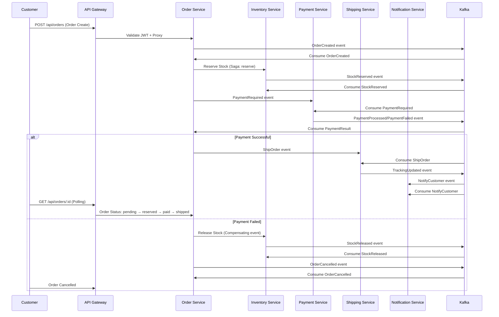

# 🎯 Event-Driven E-Commerce Platform — Portfolio Documentation

*Production-grade backend architecture: 6 Kafka-choreographed microservices behind an API gateway, saga orchestration with compensation, and K8s-ready infra.*

> **Status**: Complete source code, architecture diagrams, and local setup instructions. Ready to impress recruiters and interviewers.

---

## 📊 Architecture Overview

```mermaid
graph TD
    %% Services
    subgraph Gateway [API Gateway: Port 8081]
        GW[Gateway (Node/Express)]
    end

    subgraph SF [Storefront]
        SF1[Next.js Storefront: Port 3006]
    end

    subgraph AD [Admin Dashboard]
        AD1[Next.js Admin: Port 3007]
    end

    %% Kafka
    subgraph KafkaCluster [Kafka Cluster]
        K[Kafka Broker]
    end

    %% Databases
    subgraph PG [PostgreSQL Instances]
        PG1[(order-db)]
        PG2[(inventory-db)]
        PG3[(shipping-db)]
        PG4[(payment-db)]
        PG5[(notification-db)]
        PG6[(cart-db)]
    end

    %% Redis
    subgraph Redis [Redis Cache]
        RED[Redis]
    end

    %% Services
    OS[order-service: 3000]\nSaga Orchestrator
    IS[inventory-service: 3001]\nStock Reserve/Release
    SS[shipping-service: 3002]\nFulfillment/Tracking
    PS[payment-service: 3003]\nPayments/Refunds
    NS[notification-service: 3004]\nEmail/SMS
    CS[cart-recommendation: 3005]\nCarts + Recommendations

    %% Connections
    GW -->|HTTP JSON| OS
    GW -->|HTTP JSON| IS
    GW -->|HTTP JSON| SS
    GW -->|HTTP JSON| PS
    GW -->|HTTP JSON| NS
    GW -->|HTTP JSON| CS

    OS -->|Kafka Events| K
    IS -->|Kafka Events| K
    SS -->|Kafka Events| K
    PS -->|Kafka Events| K
    NS -->|Kafka Events| K
    CS -->|Kafka Events| K

    K -->|Consumes| OS
    K -->|Consumes| IS
    K -->|Consumes| SS
    K -->|Consumes| PS
    K -->|Consumes| NS
    K -->|Consumes| CS

    OS -->|DATABASE| PG1
    IS -->|DATABASE| PG2
    SS -->|DATABASE| PG3
    PS -->|DATABASE| PG4
    NS -->|DATABASE| PG5
    CS -->|DATABASE| PG6

    GW -->|REDIS CACHE| RED
    OS -->|RATE LIMITS| RED

    %% Frontend connections
    SF1 -->|HTTPS| GW
    AD1 -->|HTTPS| GW

    style Gateway fill:#e3f2fd,stroke:#1976b2,stroke-width:2px
    style KafkaCluster fill:#fff3e0,stroke:#fb8c00,stroke-width:2px
    style PG fill:#e8f5e9,stroke:#388e3c,stroke-width:1px,stroke-dasharray: 5 5
    style Redis fill:#fff8e1,stroke:#f57c00,stroke-width:1px,stroke-dasharray: 5 5
    style Services fill:#f3e5f5,stroke:#8e24aa,stroke-width:1px,stroke-dasharray: 5 5
    style Frontends fill:#e0f7fa,-badge:true,stroke:#00bcd4,stroke-width:2px
```

---

## 🔄 Saga Orchestration Flow (Order Journey)



---

## 📦 Event Schema Catalogue

| Topic | Key | Description |
|-------|-----|-------------|
| `order.created` | `orderId, customerId, items, total` | Initial order creation |
| `stock.reserved` | `orderId, sku, quantity` | Inventory reservation |
| `stock.released` | `orderId, sku, quantity` | Compensation — stock release on failure |
| `payment.required` | `orderId, amount, provider` | Payment initiation |
| `payment.processed` | `orderId, transactionId, amount` | Payment success |
| `payment.failed` | `orderId, errorCode` | Payment failure — triggers compensation |
| `shipment.dispatched` | `orderId, trackingNumber, carrier` | Shipping fulfillment |
| `notification.send` | `userId, type, payload` | Email/SMS dispatch |
| `<svc>.dlq` | Dead letters | Failed events — peek/replay via admin API |

---

## 🗄️ Database Schema (Prisma Shared)

Single Prisma schema (`shared/prisma`) migrated into **7 separate PostgreSQL databases** — one per service + gateway.

```prisma
model Order {
  id        String   @id @default(uuid())
  status    String   @default("pending")
  sku       String
  quantity  Int
  total     Float
  createdAt DateTime @default(now())
  updatedAt DateTime @updatedAt
}

model Product {
  sku       String   @id
  name      String
  price     Float
  stock     Int      @default(0)
  reserved  Int      @default(0)
}
```

> **Key**: Each service owns its DB — `order-service` DB, `inventory-service` DB, etc. No cross-service queries. Saga compensation uses **outbox pattern** + `prisma.$transaction` for atomicity.

---

## 🔧 Tech Stack

| Layer | Technology |
|-------|-----------|
| **Language** | TypeScript (Node 20) |
| **Backend** | 6 × Node/Express services + API Gateway |
| **Messaging** | Apache Kafka (7.6.1) |
| **Database** | PostgreSQL (7 instances, per-service) |
| **Cache** | Redis (rate limiting at gateway) |
| **ORM** | Prisma 5 (shared package) |
| **Frontend** | Next.js 14 + TypeScript + Tailwind + shadcn/ui |
| **Container** | Docker + Docker Compose |
| **Orchestration** | Docker Compose (local) / K8s (production-ready) |
| **Observability** | Prometheus + Grafana + /metrics endpoints |
| **Chaos Testing** | Runtime kill-switches per service |
| **CI/CD** | GitHub Actions (per-service path filtering) |
| **Load Testing** | k6 (smoke + order-flow) |

---

## ✨ Key Features to Impress HR

| Feature | What It Demonstrates |
|---------|----------------------|
| **Saga Pattern** | Distributed transaction orchestration with compensating events — handles failures gracefully (payment fail → stock released → order cancelled) |
| **Outbox Pattern** | Atomic DB write + Kafka publish via `prisma.$transaction` — eliminates duplicate/missing events |
| **Idempotency Keys** | Dedup against Kafka's at-least-once delivery — safe retries without double-effects |
| **Circuit Breakers** | Custom wrappers around external calls (Stripe, image pipelines) — prevents cascade failures |
| **Dead Letter Queues** | `<topic>.DLQ` with admin `peek/replay` — production-grade error handling |
| **Runtime Chaos Kill-Switches** | Admin can fail inventory/payment/shipping on-demand (no restart) — resilience engineering |
| **Per-Service Rate Limiting** | Redis-backed at API Gateway — 300 req/api, 60 auth per window |
| **Two JWT Sets** | Access tokens (15min) + internal service JWTs + refresh tokens (7d) — zero-trust service-to-service |
| **Kubernetes Ready** | `infrastructure/kubernetes/` — namespace, StatefulSets, Deployments, HPA |
| **Two Frontends** | Storefront + Admin Dashboard (Next.js) — full stack demo |
| **Load Testing** | k6 scripts ready — performance validation |

---

## 🚀 Local Setup (No Credit Card Required)

### Option A: Docker Compose (Full Stack)

```sh
# 1. Clone & enter project
git clone <your-repo-url>
cd product

# 2. Start infrastructure (Postgres + Kafka + Redis)
cd infrastructure
cp .env.example .env  # Sets POSTGRES_PASSWORD=00000000
docker compose up --build -d

# 3. Wait ~60s, then migrate each service DB
cd ../services/order-service && npm install && npm run db:migrate && cd ../..
cd ../services/inventory-service && npm install && npm run db:migrate && npm run seed && cd ../..
# repeat for: shipping, payment, notification, cart-recommendation

# 4. Start all services + gateway + observability
cd ..
start-all.bat  # Windows: opens 9 terminals

# 5. Access points
# Gateway: http://localhost:8081
# Services: ports 3000-3005
# Prometheus: http://localhost:9090
# Grafana: http://localhost:3100 (admin/admin)
```

### Option B: Cloudflare Tunnel (Expose Without Port Exposure)

```sh
# Install cloudflared (free, email-only signup)
# https://developers.cloudflare.com/tunnel/

# Create tunnel & get free HTTPS URL
cloudflared tunnel create my-ecom-platform
cloudflared tunnel route dns my-ecom-platform example.cloudflare.com

# Expose gateway (port 8081)
cloudflared tunnel --url http://localhost:8081 run my-ecom-platform

# Set frontend env: NEXT_PUBLIC_API_URL=https://my-ecom-platform.cloudflare.com
# Deploy frontends to Vercel/Cloudflare Pages/Netlify (free, no credit card)
```

> **Result**: Full architecture running on your machine, publicly accessible via free Cloudflare HTTPS URL. Zero credit card needed.

---

## 📡 API Endpoints Summary

| Service | Base URL | Key Endpoints |
|---------|----------|---------------|
| **Gateway** | `http://localhost:8081` | `POST /auth/register`, `POST /auth/login`, `POST /api/orders`, `GET /api/orders/:id`, `GET /api/<svc>/admin/dlq`, `POST /api/<svc>/admin/dlq/replay`, `GET|POST /api/<svc>/admin/chaos` |
| **Order** | `http://localhost:3000` | Saga management, order state transitions |
| **Inventory** | `http://localhost:3001` | `PUT /api/inventory/products/:sku`, image upload, `GET /api/inventory/images/*` |
| **Payment** | `http://localhost:3003` | Mock Stripe provider, refunds |
| **Shipping** | `http://localhost:3002` | Fulfillment, tracking |
| **Notification** | `http://localhost:3004` | Email/SMS (mock) |
| **Cart/Recommendation** | `http://localhost:3005` | Carts + frequently-bought-together |

---

## 📸 Screenshots (Placeholder — replace with your local runs)

| Feature | Suggested Screenshot |
|---------|----------------------|
| Order journey (saga state changes) | `pending → reserved → paid → shipped` |
| Admin Dashboard — Chaos Lab | Kill-switch toggles + live event flow |
| DLQ Management | `GET /api/orders/admin/dlq` + replay |
| Grafana Dashboard | Prometheus metrics + service health |
| Storefront | Customer shop UI |
| API Gateway Rate Limiting | 429 responses simulated |

---

## 📦 Project Structure (High-Level)

```
product/
├── infrastructure/     # Docker Compose + K8s configs
├── services/          # 6 microservices + auth-types
├── api-gateway/       # JWT auth + per-service proxy + rate limiting
├── frontend/          # storefront + admin-dashboard (Next.js)
├── shared/            # prisma (single schema), platform (DLQ/chaos/metrics), event-schemas
├── observability/     # Prometheus + Grafana configs
├── load-tests/        # k6 smoke + order-flow scripts
├── AGENT.md           # Architecture brief
├── README.md          ← This file (for HR) — first thing they see
└── start-all.bat / start-services.bat  # Windows launchers
```

---

## 🎓 Why This Impresses Recruiters/Interviewers

1. **Real-world patterns**: Saga, outbox, idempotency, DLQ, circuit breaker — all production-grade
2. **Full stack**: 6 microservices + 2 frontends + Kafka + Postgres + Redis + Docker + K8s
3. **Resilience focus**: Runtime chaos testing, compensation, idempotent consumers
4. **Observability**: /metrics on every service, Prometheus + Grafana configured
5. **DevOps depth**: GitHub Actions CI, k6 load tests, Docker multi-stage builds, K8s manifests
6. **Type-safe end-to-end**: TypeScript shared schemas, Prisma single source of truth
7. **Event-driven design**: All communication via Kafka topics — no direct HTTP between services
8. **Scalable architecture**: K8s-ready, HPA configured, per-service DB scaling

---

## 📬 Next Steps for Your Portfolio

1. **Clone the repo** and run `start-all.bat` or use Cloudflare Tunnel (Option B)
2. **Add screenshots** of local runs (Grafana dashboard, order journey, admin chaos lab)
3. **Fork on GitHub** — the repo structure is polished and documentation-ready
4. **Talk track**: "This platform demonstrates distributed sagas with compensation, outbox pattern for reliable event publishing, runtime chaos testing, and full observability — all containerized and production-ready."
5. **Optional**: Deploy frontends to Vercel/Cloudflare Pages (free, no credit card) and point to your tunnel URL

---
*Built as a from-scratch portfolio project demonstrating production-grade backend architecture. Mirrors the kind of order-processing systems used by Amazon/Shopify.*